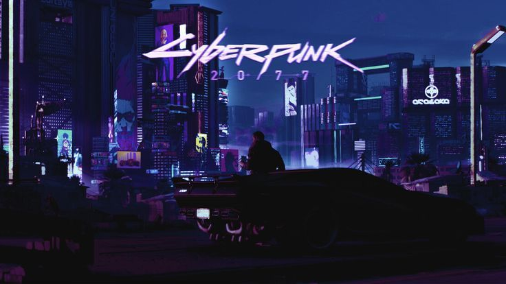
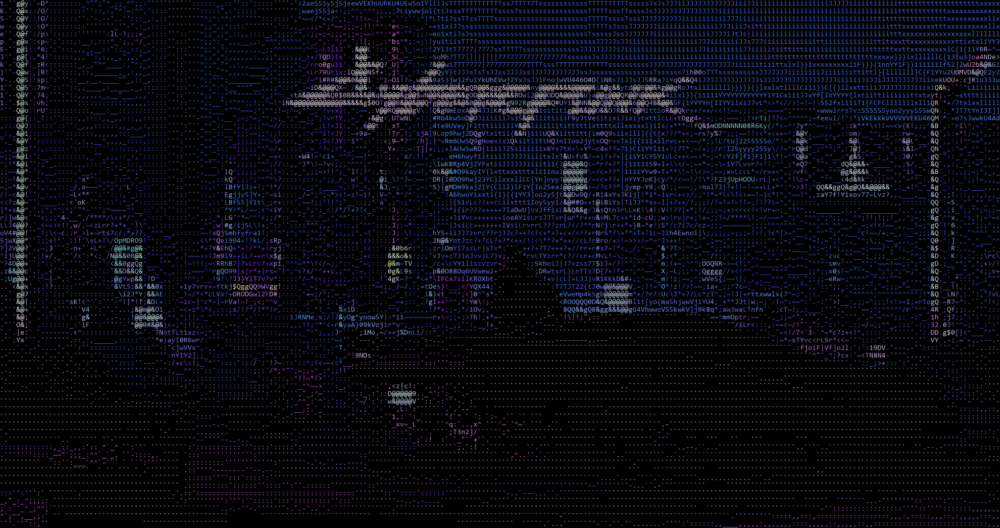

# ascii-generator

Convierte una imagen en arte ASCII a color y la guarda como texto (`.txt`) y como imagen (`.png`) dibujada con los propios símbolos.

Proyecto de aprendizaje: está escrito paso a paso con Python y NumPy, buscando entender cada etapa del procesamiento y no solo obtener el resultado.

## Ejemplo

| Original | ASCII |
|---|---|
|  |  |

Resultado con fondo oscuro y color promedio por bloque. También está disponible como [texto plano](salida_ascii.txt) (sin color).

## Características

- Lee cualquier imagen que soporte Pillow (PNG, JPG, GIF, etc.).
- Elige el símbolo de cada bloque según su **luminancia** (brillo percibido).
- Colorea cada símbolo con el **color promedio** del bloque (terminal y PNG).
- Exporta a texto plano (`salida_ascii.txt`) y a imagen (`salida_ascii.png`).
- Soporta **fondo oscuro o claro** (la rampa de símbolos se invierte sola).
- Ajustes de imagen: gamma, estiramiento de contraste por percentiles y avivado de color.
- La rampa de símbolos se puede construir midiendo la **densidad de tinta** de cada carácter ASCII con la fuente elegida.

## Cómo funciona

```
imagen ─► RGB (alto, ancho, 3) ─► luminancia (alto, ancho)
                │                         │
                │                         ▼
                │              división en bloques (reshape)
                │                         │
                ▼                         ▼
      color promedio por bloque   brillo promedio por bloque
                │                         │
                │                         ▼
                │              símbolo según brillo (rampa)
                └──────────┬──────────────┘
                           ▼
                texto con color  /  .txt  /  .png
```

1. **Carga:** la imagen se convierte a RGB y se pasa a un arreglo de NumPy en decimal (evita el desborde de `uint8`).
2. **Luminancia:** `L = 0.2126·R + 0.7152·G + 0.0722·B`, un número de brillo por píxel.
3. **Bloques:** la imagen se divide en bloques rectangulares con `reshape`. Cada bloque será un carácter. El alto del bloque compensa que los caracteres son más altos que anchos, usando la proporción real de la fuente.
4. **Símbolo:** el brillo promedio del bloque se convierte en un símbolo de la rampa (de más a menos tinta).
5. **Color:** el color promedio del bloque se usa como tinta del símbolo.
6. **Salida:** se imprime en la terminal con secuencias ANSI, se guarda el texto plano y se dibuja el PNG.

## Requisitos

- Python 3.9 o superior
- [NumPy](https://numpy.org/)
- [Pillow](https://python-pillow.org/)

## Instalación

```bash
git clone https://github.com/<tu-usuario>/ascii-generator.git
cd ascii-generator

python -m venv .venv
# Windows (PowerShell): .venv\Scripts\Activate.ps1
# Linux / macOS:        source .venv/bin/activate

pip install -r requirements.txt
```

## Uso

1. Copiá tu imagen a la carpeta del proyecto.
2. Editá la sección de configuración al inicio de `gen.py`.
3. Ejecutá:

```bash
python gen.py
```

Se generan `salida_ascii.txt` y `salida_ascii.png`, y el resultado con color se imprime en la terminal.

### Configuración

| Parámetro | Descripción |
|---|---|
| `RUTA` | Imagen de entrada. |
| `COLUMNAS_ASCII` | Ancho deseado en caracteres. Más columnas, más detalle. |
| `FUENTE_ARCHIVO` | Fuente **monoespaciada** (`consola.ttf` en Windows, `DejaVuSansMono.ttf` en Linux). |
| `TAM_FUENTE` | Tamaño de la fuente; define el tamaño de cada celda del PNG. |
| `FONDO_OSCURO` | `True`: fondo negro. `False`: fondo blanco. |
| `GAMMA` | `1.0` no cambia nada; menor que 1 aclara la imagen. |
| `USAR_PERCENTILES` | Estira el contraste usando los percentiles 2 y 98 del brillo. |
| `AVIVAR_COLOR` | `0` conserva el color original; `1` lleva cada color a máxima intensidad. |
| `NUM_SIMBOLOS` | Cantidad de símbolos de la rampa (95 = todos los ASCII imprimibles). |

## Notas

- El `.txt` se guarda **sin color**. Los colores de la terminal son secuencias ANSI, que un editor de texto mostraría como caracteres extraños.
- En Windows, los colores se ven bien en Windows Terminal o en la terminal de VS Code. El `cmd` clásico puede no interpretarlos.
- Con `USAR_PERCENTILES = True`, una imagen de un solo color uniforme produce una división por cero; para esas imágenes de prueba, desactivalo.
- Las imágenes con zonas oscuras parejas (siluetas sobre fondo oscuro) son difíciles para cualquier conversor ASCII. Probá `GAMMA` menor que 1, `AVIVAR_COLOR` y `USAR_PERCENTILES` para recuperar detalle.

